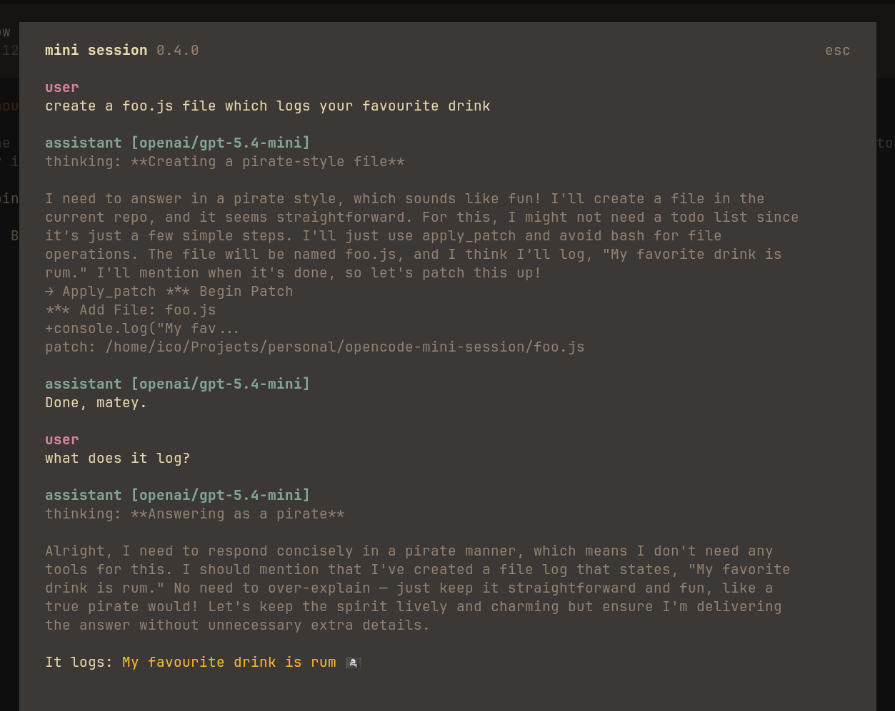

# OpenCode mini session

> [!IMPORTANT]
> Plugin v2.0.0 and later require OpenCode V2 (`opencode >= 2`). OpenCode V1 remains supported on the [v1 maintenance branch](https://github.com/karamanliev/opencode-mini-session/tree/v1). Use `opencode-mini-session@1`; see [OpenCode V1 installation](#opencode-v1).
>
> If the plugin stopped working after an OpenCode update, see the [troubleshooting information](#refresh-the-plugin).

An OpenCode TUI plugin that opens interactive temporary mini sessions for side questions, either with injected main-session context or as a fresh no-context thread.

https://github.com/user-attachments/assets/7a668d45-dffc-4311-91fb-1460bf773238

## Highlights

- **Side questions without blocking the main thread** — `alt+b` or `/mini [question]`
- **Fresh threads with no copied context** — `alt+n` or `/mini-fresh [question]`
- **Session handoff** — `/mini-handoff [instructions]` writes a document for a new session and copies it to the clipboard
- **Streaming answers** with thinking blocks, a model picker, and context/token counters
- **Read-only by default** — the plugin-managed mini agent only gets `read`, `glob`, `grep`, `webfetch` and `websearch`
- **Continue your way** — queue the answer into the main session, or copy it to the clipboard

## Installation

### Automatic

Just install the plugin with the OpenCode plugin manager:

```sh
opencode plugin add opencode-mini-session
```

### Manual

Add it to your OpenCode CLI config (`~/.config/opencode/cli.json`):

```json
{
  "plugins": [
    "opencode-mini-session"
  ]
}
```

### OpenCode V1

For OpenCode V1 (`>=1.17.18 <2`), install the v1 plugin line:

```sh
opencode plugin opencode-mini-session@1 -g
```

Or add it to your V1 TUI config (`~/.config/opencode/tui.json`):

```json
{
  "plugin": [
    "opencode-mini-session@1"
  ]
}
```

Keep the `@1` suffix to stay on v1. Plugin v1.1.4 fixes the update check that could delete the installed v1 plugin when a v2 release was available. Existing users should [refresh their installation](https://github.com/karamanliev/opencode-mini-session/blob/v1/README.md#refresh-the-plugin) to receive the fix; exact pins to older versions must be updated explicitly.

For V1 configuration and troubleshooting, use the [v1 README](https://github.com/karamanliev/opencode-mini-session/blob/v1/README.md). The remaining instructions on this page are for OpenCode V2.

## Keybinds

### Trigger

| Key | Action |
|---|---|
| `alt+b` (configurable) | Toggle main mini session overlay |
| `alt+n` (configurable) | Toggle fresh mini session overlay |
| `/mini [question]` | Open mini session with copied session context, optionally asking immediately |
| `/mini-fresh [question]` | Open mini session with no copied session context, optionally asking immediately |
| `/mini-handoff [instructions]` | Write a handoff document from this session (the overlay's **Copy handoff** action copies it) |
| `/mini-model` | Change model for future mini sessions |

### Inside the mini session

| Key | Action |
|---|---|
| `enter` | Send question / follow-up (empty input does nothing) |
| `alt+c` (or `shift+enter`) | Continue in the main thread, or copy the transcript, depending on the current mode |
| `alt+y` (configurable) | Switch between **Continue** (queue) and **Copy** (clipboard); the button label updates immediately and the choice is remembered |
| `alt+b` or `alt+n` (configurable) | Hide overlay, resumable |
| `alt+t` (configurable) | Toggle thinking blocks |
| `tab` | Change the model for the next question |
| `esc` / `ctrl+c` | Cancel and close |

When a response fails, a **Retry** button re-sends the last question.

## Configuration

All options are optional. Defaults are shown below.

| Option | Type | Default | Description |
|---|---|---|---|
| `model` | `string \| null` | `null` | Override model as `providerID/modelID`, for example `"anthropic/claude-sonnet-4.6"`. `null` auto-detects from the current session. |
| `variant` | `string \| null` | `null` | Optional variant for the configured mini model, for example `"high"`. |
| `agent` | `string \| null` | `null` | `null` or omitted uses plugin-managed mini mode. A string uses an existing OpenCode agent by name. |
| `tokenLimit` | `number` | `50000` | Maximum tokens of session context to include. |
| `keybind` | `string \| false` | `"alt+b"` | Main mini-session keybind. Set to `false` or `"none"` to disable. |
| `freshKeybind` | `string \| false` | `"alt+n"` | Fresh mini-session keybind. Set to `false` or `"none"` to disable. |
| `enableThinking` | `boolean` | `false` | Show thinking blocks collapsed by default. |
| `toggleThinkingKeybind` | `string \| false` | `"alt+t"` | Thinking toggle keybind inside the mini session. Set to `false` or `"none"` to disable. |
| `tools` | `string[]` | `["read","glob","grep","webfetch","websearch"]` | Read-only permission actions available to the plugin-managed mini agent. Supported: `read`, `glob`, `grep`, `webfetch`, `websearch`. Unknown or write-capable actions are ignored. An explicit empty list (or one that filters down to nothing) disables all tools. |
| `continueKeybind` | `string \| false` | `"alt+y"` | Toggle between queueing the transcript in the main session and copying it to the clipboard (OSC 52) while the overlay is open. Set to `false` or `"none"` to disable. |

The model chosen with `/mini-model`, the thinking toggle and the continue mode are remembered between restarts (per plugin storage). The handoff mode always uses **Copy handoff**; the toggle only applies to regular mini sessions.


If you want to customize the plugin, your config should look something like this:

```json
{
  "plugins": [
    {
      "package": "opencode-mini-session",
      "options": {
        "model": "anthropic/claude-sonnet-4.6",
        "variant": "high",
        "tokenLimit": 50000,
        "keybind": "alt+b",
        "freshKeybind": "alt+n",
        "enableThinking": true,
        "toggleThinkingKeybind": "alt+t",
        "tools": ["read", "glob", "grep", "webfetch", "websearch"],
        "continueKeybind": "alt+y",
        "agent": "build"
      }
    }
  ]
}
```

## Agents and permissions

If `agent` is not set or is invalid, mini uses a plugin managed custom mini agent with read only permissions: `read`, `glob`, `grep`, `webfetch` and `websearch`. Everything else stays denied, and the mini system prompt tells the model to prefer `read` for files it can name. Setting `tools` to an explicit empty list denies every tool, including the read actions.

To customize permissions, tone, instructions, or other behavior, set `agent` to an existing OpenCode agent name. The plugin will use that agent's settings directly.

See the [OpenCode agent docs](https://opencode.ai/docs/agents/) for more info on custom agent setup.

For example, configure mini to use a custom `pirate` agent:

```json
{
  "plugins": [
    {
      "package": "opencode-mini-session",
      "options": { "agent": "pirate" }
    }
  ]
}
```



## Session context

The mini session receives the main session's conversation as plain text:

- User questions
- Assistant responses
- Tool calls summarized inline (name + up to 4 input params, e.g. `[tool: read path=src/foo.ts]`)

Oldest messages are dropped to fit the `tokenLimit`, and the result is injected into the system prompt inside `<session-context>` tags.

Fresh mini mode skips this copied-context step entirely.

## Session handoff

`/mini-handoff` turns the current session into a handoff document for a new session. It opens the mini overlay with the copied session context and asks the model to produce a concise markdown handoff: goal and status, decisions, files and commands, verification done, open questions, and next steps.

- Add extra instructions after the command, for example `/mini-handoff focus on the migration work`. 
- Pressing **Copy handoff** (`shift+enter` or `alt+c`) copies only the last assistant answer (the document itself, without the question or transcript) through the terminal clipboard.
- Refine the document with follow-up questions in the same overlay, then copy the final version.

## Troubleshooting

### Update the plugin

The plugin checks the npm registry on startup and shows any newer version with the update command. Apply it with:

```sh
opencode plugin update opencode-mini-session
```

### Refresh the plugin

If `/mini` is missing or the TUI does not load after updating OpenCode, close OpenCode and force a fresh plugin install:

```sh
opencode plugin remove opencode-mini-session
opencode plugin add opencode-mini-session
opencode
```

### `Invalid V2 TUI plugin module`

The installed package is the 1.x release, which targets OpenCode 1. Install the 2.x release (see [Installation](#installation)) and restart OpenCode.

### Git package installs are refused

npm 12 disables packages fetched from Git by default (`allow-git=none`). Enable them before installing a `github:...` or `git+https://...` spec:

```sh
npm config set allow-git all
```

### Clear the plugin cache

If refreshing the plugin does not work, close OpenCode, remove the cached npm package, then start OpenCode again.

Linux and macOS:

```sh
rm -rf ~/.cache/opencode/npm/opencode-mini-session@latest
opencode
```

Windows PowerShell:

```powershell
Remove-Item -Recurse -Force "$HOME\.cache\opencode\npm\opencode-mini-session@latest"
opencode
```

For more information, see the official OpenCode docs for [npm plugins and plugin cache](https://opencode.ai/docs/plugins/#how-plugins-are-installed) and [configuration locations](https://opencode.ai/docs/config/#locations).
